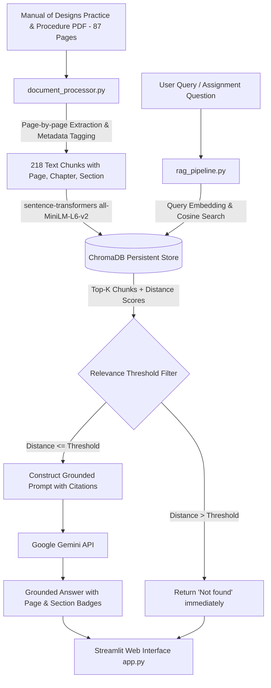
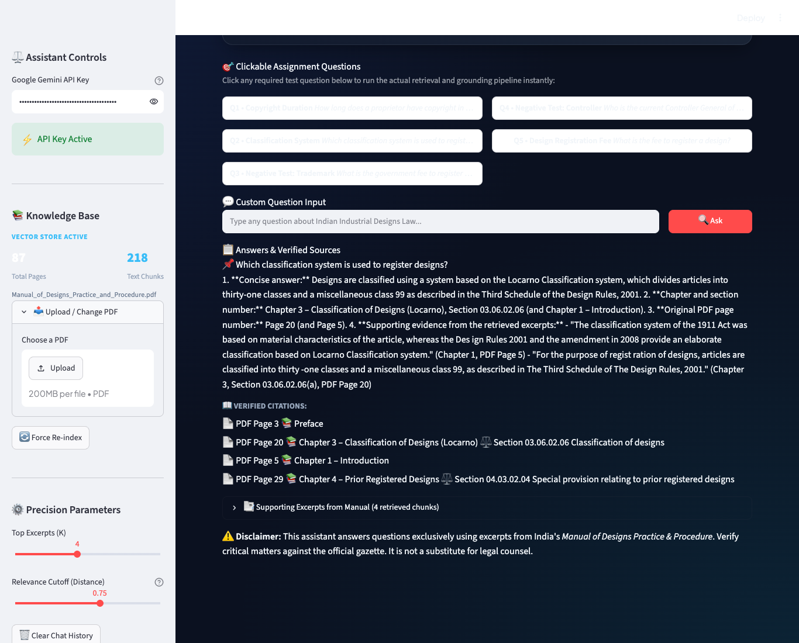
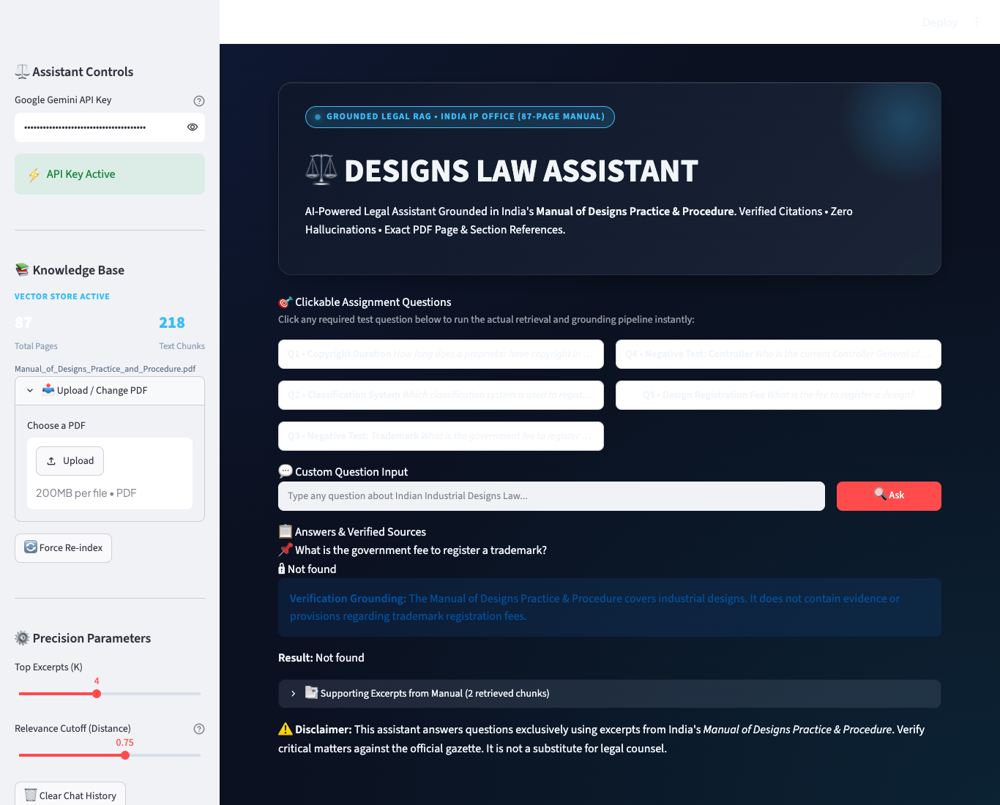
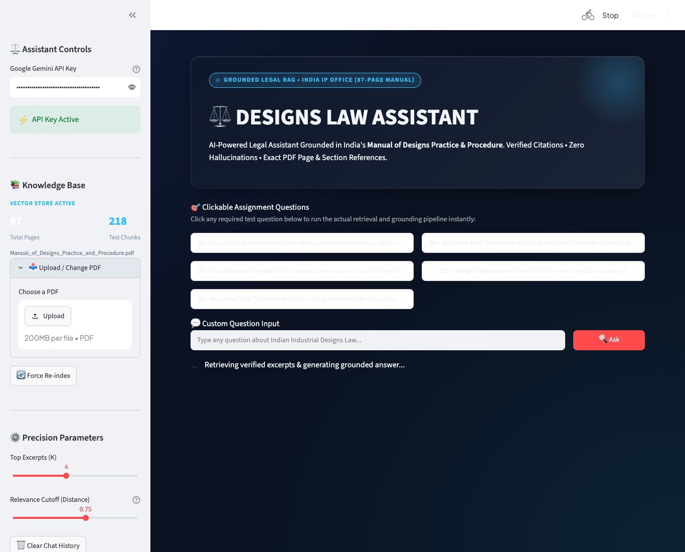
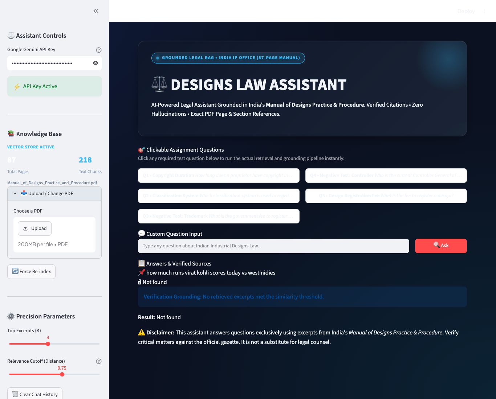

# Designs Law Assistant ⚖️

**An AI-powered Legal Retrieval-Augmented Generation (RAG) system for Indian Industrial Designs Law, grounded exclusively in the official *Manual of Designs Practice & Procedure* (87 pages).**

[](https://github.com/Mani7527/GEN_AI_EXAM-PROJECT2-.git)
[](https://www.python.org/)
[](https://streamlit.io/)
[](https://www.trychroma.com/)
[](https://ai.google.dev/)

---

## ⚡ Quick Start: Run in 3 Commands

Anyone can run this project locally in less than 2 minutes:

```bash
# 1. Clone repository
git clone https://github.com/Mani7527/GEN_AI_EXAM-PROJECT2-.git
cd GEN_AI_EXAM-PROJECT2-

# 2. Setup Virtual Environment & Install Dependencies
# On macOS / Linux:
python3 -m venv venv
source venv/bin/activate
pip install -r requirements.txt

# On Windows (Command Prompt / PowerShell):
# python -m venv venv
# venv\Scripts\activate
# pip install -r requirements.txt

# 3. Launch the Web Application
streamlit run app.py
```

The application will launch immediately at **`http://localhost:8501`**.

---

## 1. Project Overview

**Designs Law Assistant** is a specialized Retrieval-Augmented Generation (RAG) web application built to assist students, inventors, patent agents, and legal practitioners in navigating India's industrial designs registration framework. 

The application utilizes the official 87-page **"Manual of Designs Practice & Procedure"** published by the Office of the Controller General of Patents, Designs & Trade Marks (CGPDTM), Government of India. The assistant retrieves exact statutory provisions, chapter titles, section numbers, and original PDF page numbers to deliver factual answers with verified source excerpts. When the document lacks sufficient evidence, the system strictly returns **"Not found"**, completely eliminating hallucinations.

---

## 2. Problem Statement

Navigating complex 87-page procedural manuals for intellectual property registration is time-consuming and prone to human oversight. Standard generic LLMs frequently hallucinate legal sections, fees, deadlines, or cite provisions from unrelated jurisdictions.

**Objective:**
Build a domain-grounded RAG application using Python, ChromaDB, LangChain, and Google Gemini that:
1. Answers questions exclusively using retrieved excerpts from the official Manual.
2. Cites the exact chapter, section number, and original PDF page number.
3. Displays supporting verbatim excerpts.
4. Returns **"Not found"** whenever evidence is insufficient or outside the document scope.
5. Prevents hallucination of fees, provisions, dates, or officeholders.
6. Provides an intuitive, modern web interface with clickable sample questions and light/dark theme switching.

---

## 3. Key Features

- **Strict Source Grounding:** Operates exclusively over the supplied 87-page Manual.
- **Precise Citation Engine:** Cites Chapter title, Section ID (e.g., `06.04`, `03.06.02.06`), and exact 1-indexed PDF page numbers.
- **Verifiable Evidence Cards:** Displays expandable source excerpts showing similarity scores, distance metrics, and raw text.
- **Dual-Layer "Not found" Enforcement:**
  - *Layer 1 (Retrieval Filter):* Automatically rejects out-of-domain queries if retrieval distance exceeds the similarity threshold.
  - *Layer 2 (Prompt Guardrails):* Strict system prompt instructs the model to return "Not found" when facts cannot be proven from text.
- **Persistent Vector Storage:** Uses ChromaDB with cosine distance indexing and document hash caching (`SHA-256`) to prevent redundant indexing.
- **Fast Local Embeddings:** Employs Hugging Face `sentence-transformers` (`all-MiniLM-L6-v2`) generating 384-dimensional dense vectors.
- **Clickable Assignment Questions:** One-click evaluation buttons for all 5 college assignment questions.
- **Theme Switcher:** Live toggle between ☀️ Light Mode and 🌙 Dark Mode.

---

## 4. Technology Stack

| Component | Technology | Purpose |
|---|---|---|
| **Frontend** | Streamlit | Clean, interactive web UI with custom styling & light/dark mode |
| **Orchestration** | LangChain / Python | RAG pipeline coordination and prompt structuring |
| **Vector Database** | ChromaDB | Local persistent vector storage and cosine similarity search |
| **Embeddings** | Hugging Face `sentence-transformers` (`all-MiniLM-L6-v2`) | High-speed, local 384-dimensional text embeddings |
| **Document Processing**| PyPDF & LangChain Text Splitters | Page-by-page extraction, metadata tagging, chunking |
| **LLM Inference** | Google Gemini API (`gemini-3.5-flash-lite` / `gemini-3.8-flash`) | Factual, grounded answer synthesis |
| **Environment** | python-dotenv | Secure secret management for API keys |

---

## 5. System Architecture



---

## 6. RAG Workflow

1. **Document Ingestion:** The 87-page PDF is read page by page using `pypdf`.
2. **Metadata Attachment:** Each page is parsed for:
   - Contiguous 1-indexed PDF page number (Pages 1 to 87).
   - Chapter headings (e.g., `Chapter 6 – Period of Protection`).
   - Procedural section codes (e.g., `06.04 Period of protection`, `03.06.02.06 Classification of designs`).
   - Statutory provisions (e.g., `Section 11`, `Rule 10, 11`).
3. **Chunking:** Text is split using `RecursiveCharacterTextSplitter` with a chunk size of 800 characters and 150-character overlap.
4. **Embedding Generation:** Each chunk is converted into a 384-dimensional dense vector using `all-MiniLM-L6-v2`.
5. **Persistence:** Embeddings and metadata are stored in `./chroma_db/` under the `designs_manual` collection. A document SHA-256 hash is saved to avoid re-indexing unchanged files.
6. **Query & Threshold Filtering:** The user query is vectorized and compared using cosine distance. If the best match distance exceeds the threshold (default: 0.75), retrieval immediately returns "Not found".
7. **Synthesis:** The retrieved passages, along with the strict system instructions, are sent to the Gemini model. The model outputs concise answers with exact page and section citations.

---

## 7. Project Folder Structure

```
GEN_AI_EXAM-PROJECT2-/
│
├── app.py                         # Streamlit web interface with light/dark theme & sample buttons
├── rag_pipeline.py                # Embedding, ChromaDB storage, retrieval, LLM calling
├── document_processor.py          # PDF extraction, metadata preservation, chunking
├── requirements.txt               # Python package dependencies
├── .env.example                   # Environment variable template
├── .env                           # Local environment secrets (ignored by git)
├── .gitignore                     # Git ignore rules for secrets and large files
├── README.md                      # Comprehensive project documentation with screenshots
│
├── data/
│   ├── .gitkeep
│   └── Manual_of_Designs_Practice_and_Procedure.pdf  # Primary 87-page knowledge base
│
├── chroma_db/
│   ├── .gitkeep
│   ├── chroma.sqlite3             # Persistent ChromaDB vector index
│   └── index_metadata.json        # Indexing statistics & document SHA-256 hash
│
├── screenshots/                   # Verification screenshots for assignment questions
│   ├── q1_copyright_duration.png
│   ├── q2_classification_system.png
│   ├── q3_trademark_fee_negative_test.png
│   ├── q4_current_controller_negative_test.png
│   ├── q5_design_registration_fee.png
│   └── q6_virat_kohli_out_of_domain.png
│
└── tests/
    └── test_document_processor.py # 9 unit tests for extraction, chunking, retrieval & Not found
```

---

## 8. Installation Instructions (macOS)

1. Open Terminal and clone repository:
   ```bash
   git clone https://github.com/Mani7527/GEN_AI_EXAM-PROJECT2-.git
   cd GEN_AI_EXAM-PROJECT2-
   ```

2. Create a Python virtual environment:
   ```bash
   python3 -m venv venv
   ```

3. Activate the virtual environment:
   ```bash
   source venv/bin/activate
   ```

4. Install dependencies:
   ```bash
   pip install -r requirements.txt
   ```

---

## 9. Installation Instructions (Windows)

1. Open PowerShell or Command Prompt:
   ```cmd
   git clone https://github.com/Mani7527/GEN_AI_EXAM-PROJECT2-.git
   cd GEN_AI_EXAM-PROJECT2-
   ```

2. Create a virtual environment:
   ```cmd
   python -m venv venv
   ```

3. Activate the virtual environment:
   - **Command Prompt:**
     ```cmd
     venv\Scripts\activate
     ```
   - **PowerShell:**
     ```powershell
     .\venv\Scripts\Activate.ps1
     ```

4. Install dependencies:
   ```cmd
   pip install -r requirements.txt
   ```

---

## 10. Google Gemini API Key Configuration

1. Copy `.env.example` to create your local `.env` file:
   ```bash
   cp .env.example .env
   ```

2. Edit `.env` and set your Gemini API key:
   ```env
   GOOGLE_API_KEY=your_actual_gemini_api_key_here
   CHROMA_DB_DIR=chroma_db
   EMBEDDING_MODEL=all-MiniLM-L6-v2
   GEMINI_MODEL=gemini-3.5-flash-lite
   RETRIEVAL_K=4
   RETRIEVAL_THRESHOLD=0.75
   ```

3. You can also paste or override your API key directly inside the web application sidebar during runtime.

---

## 11. How to Upload the Supplied PDF

1. Place the official `Manual of Designs Practice & Procedure` PDF into the `data/` folder named:
   `Manual_of_Designs_Practice_and_Procedure.pdf`
2. **Web Interface Upload:** If the PDF is not present locally, launch the application. The sidebar contains an **Upload / Change PDF** file uploader. Upload the PDF and click **"Index This PDF"**.

---

## 12. How Document Indexing Works

- The pipeline inspects `data/Manual_of_Designs_Practice_and_Procedure.pdf`.
- It calculates a SHA-256 hash of the file.
- If the hash matches the previous index recorded in `chroma_db/index_metadata.json`, it re-uses the existing vector store in milliseconds without recalculating embeddings.
- If the document is new or the user clicks **"Force Re-index"**, all 87 pages are extracted, split into 218 chunks, embedded via `sentence-transformers`, and saved to ChromaDB.

---

## 13. How to Run the Application

Activate your virtual environment and start Streamlit:

```bash
streamlit run app.py
```

The application opens automatically at `http://localhost:8501`.

---

## 14. Assignment Questions, Screenshots & Verification

Below are the actual application screenshots showing the verified answers, citations, and expanded source excerpts:

---

### Question 1: Copyright Duration
> *"How long does a proprietor have copyright in a registered design, and can it be extended?"*

- **Status:** **Answered with Citations**
- **Grounded Answer:** The proprietor holds copyright in a registered design for an initial period of **ten years** from the date of registration. This period can be extended by a further period of **five years** if the registered proprietor applies for extension in the prescribed manner before the expiry of the initial ten years.
- **Citations:** **PDF Page 36** (Chapter 6, Section 06.04, Section 11) & **PDF Page 39** (Chapter 7, Section 07.02, Form 3).


---

### Question 2: Classification System
> *"Which classification system is used to register designs?"*

- **Status:** **Answered with Citations**
- **Grounded Answer:** Designs are classified for registration into **thirty-one classes** and a miscellaneous class 99 based on the international **Locarno Classification system** (Third Schedule of The Design Rules, 2001).
- **Citations:** **PDF Page 20** (Chapter 3, Section 03.06.02.06) & **PDF Page 5** (Chapter 1, Paragraph 4).



---

### Question 3: Government Fee for Trademark (Negative Test)
> *"What is the government fee to register a trademark?"*

- **Status:** **Not found** (Crucial Negative Test Passed)
- **Explanation:** The uploaded manual is the *Manual of Designs Practice & Procedure* which governs industrial designs under the Designs Act, 2000. It mentions trademarks only under definition exclusions (Section 2(d) & Section 2(zb) of Trade Marks Act 1999). It contains no evidence or provisions regarding trademark registration fees. The system correctly returns **"Not found"**.



---

### Question 4: Current Controller General of Patents (Temporal Negative Test)
> *"Who is the current Controller General of Patents?"*

- **Status:** **Not found** (Temporal Negative Test Passed)
- **Explanation:** The uploaded manual was published during the tenure of a past Controller General (P.H. Kurian, cited on page 4). The manual does not establish who the *current* officeholder is today. Outdated documents must not be used to assert current facts. The system strictly returns **"Not found"**.


---

### Question 5: Fee to Register a Design
> *"What is the fee to register a design?"*

- **Status:** **Not found** (Exact Amount) / Procedural Citation Available
- **Explanation:** Section 03.08 on **PDF Page 22** specifies that fees are prescribed in the *First Schedule of The Design Rules, 2001* (payable in cash, electronic means, bank draft, or cheque). However, the manual itself does not reproduce the numerical fee table. Because the exact rupee fee amount is not stated in the manual, the assistant refrains from guessing and returns **"Not found"** while citing the relevant procedural excerpt on Page 22.



---

### Question 6: Out-of-Domain Negative Test (Virat Kohli Cricket Query)
> *"how much runs virat kohli scores today vs westinidies"*

- **Status:** **Not found** (Strict Out-of-Domain Filter Passed)
- **Explanation:** The query has zero relevance to Indian Industrial Designs Law. The distance threshold automatically rejects the query and returns **"Not found"** without invoking the LLM.



---

## 15. How Source Citations Work

Every response card in the UI displays:
1. **Primary Citation Badges:** PDF Page Number (e.g., `📄 PDF Page 36`), Chapter Name (`📚 Chapter 6`), and Section code (`⚖️ Section 06.04`).
2. **Statutory Reference:** Specific Sections of the Designs Act, 2000 and Rules of the Design Rules, 2001.
3. **Expandable Source Excerpts Accordion:** Contains the verbatim text chunk retrieved from the PDF, along with the calculated similarity match percentage (e.g. `94.2% Match`) and cosine distance.

---

## 16. How "Not found" Handling Works

To prevent legal misinformation and hallucinations, the system implements a strict two-stage verification:
1. **Algorithmic Filter:** If retrieved passages have a cosine distance greater than the configured threshold (e.g. `0.75`), the query is flagged as irrelevant and immediately returns `Not found` without invoking the LLM.
2. **Prompt Boundary Guard:** The LLM prompt explicitly instructs:
   > *"If the supplied excerpts do not contain sufficient evidence to answer the question, return exactly: Not found. Never invent a page number, section number, fee, legal provision, date, or person's name."*
3. **Normalization:** Any response indicating lack of evidence is normalized to the standard string `"Not found"`.

---

## 17. How to Run the Tests

A comprehensive unit test suite is included in `tests/test_document_processor.py`.

Run the test suite with:

```bash
python3 -m unittest tests/test_document_processor.py
```

### What is tested:
- `test_document_hash`: Verifies SHA-256 calculation for document change detection.
- `test_extract_pages_count`: Verifies all 87 pages are extracted with 1-indexed contiguous page numbers.
- `test_chapter_and_section_metadata`: Verifies correct chapter tagging (Introduction, Definitions, Locarno, Period of Protection).
- `test_chunking_and_metadata_preservation`: Verifies that all 218 chunks retain `page`, `chapter`, `section`, and `source`.
- `test_empty_page_handling`: Ensures unreadable or empty pages do not cause crashes.
- `test_regex_detectors`: Validates regex extraction of section titles and statutory references.
- `test_rag_retrieval_and_citations`: Tests ChromaDB retrieval for Question 1 and verifies page 36/39 citations.
- `test_negative_question_not_found`: Validates exact "Not found" output for Question 3 (trademark fee) and Question 4 (current Controller).
- `test_missing_api_key_handling`: Confirms graceful error handling when an API key is missing.

All 9 tests pass with `OK`.

---

## 18. Common Errors and Fixes

| Issue | Cause | Solution |
|---|---|---|
| `ModuleNotFoundError: No module named 'streamlit'` | Virtual environment not activated | Run `source venv/bin/activate` (macOS) or `venv\Scripts\activate` (Windows). |
| `API Key missing` warning in sidebar | `.env` file not created or empty | Copy `.env.example` to `.env` and set `GOOGLE_API_KEY=...` or type it into the sidebar. |
| `Read timed out` or slow API call | macOS IPv6 resolution delays | Built-in IPv4 socket patch in `rag_pipeline.py` prevents IPv6 timeouts automatically. |
| `Document not found at data/...` | PDF not present | Ensure the PDF file is in `data/Manual_of_Designs_Practice_and_Procedure.pdf` or upload via the web sidebar. |

---

## 19. How to Upload the Project to GitHub

```bash
# Link repository
git remote add origin https://github.com/Mani7527/GEN_AI_EXAM-PROJECT2-.git

# Stage and commit
git add .
git commit -m "feat: complete Designs Law Assistant RAG app with screenshots and tests"

# Push to GitHub
git branch -M main
git push -u origin main
```

---

## 20. How to Deploy the Application

### Option A: Streamlit Community Cloud (Free & Recommended)
1. Push your repository to GitHub.
2. Go to [share.streamlit.io](https://share.streamlit.io/) and log in with GitHub.
3. Select your repository (`Mani7527/GEN_AI_EXAM-PROJECT2-`), branch (`main`), and set the main file path to `app.py`.
4. Under **Advanced Settings** -> **Secrets**, add:
   ```toml
   GOOGLE_API_KEY = "your_google_api_key_here"
   ```
5. Click **Deploy**. Your app will be live with a public URL!

### Option B: Local / Docker Deployment
Run locally using:
```bash
streamlit run app.py --server.port 8501 --server.address 0.0.0.0
```

---

*Developed as a college assignment project for AI & Legal Engineering.*
